# Evidence — GrandCaddy Sprint

[← Back to portfolio](../)

All evidence for the sprint is collected below. Each item is labelled with what it proves.

---

## 1. Local History — work started 7 August 2026

VS Code Local History shows the earliest save on `SignUp.tsx` as **7 August 2026**, and the latest save as **October 2026**. Together they show the file was worked on across the whole sprint, not built in a single day. This is the primary evidence that work began in August — the four commits on `main` reflect when work was *pushed*, not when it was *built*.

**Earliest save — 7 August 2026:**

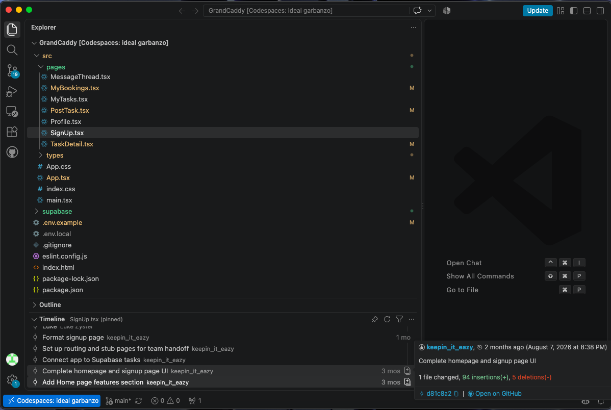

**Latest save — October 2026:**

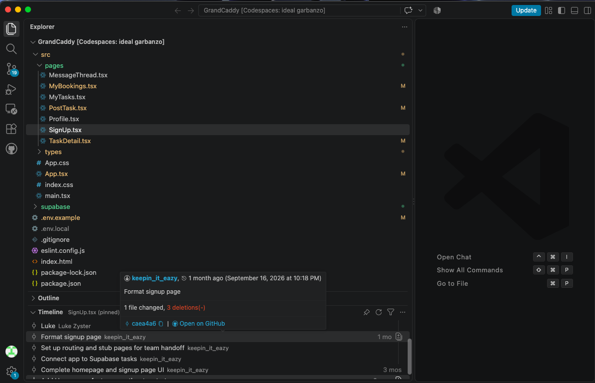

---

## 2. Commit history — 4 project commits on `main`

Running `git log --author="231269307@mycput.ac.za" --date=short --pretty=format:"%ad %s"` inside the repo returns:
2026-08-04 Update README.md
2026-10-14 Fix authentication and Supabase app flow
2026-10-14 Add Kuils River area selection
2026-10-14 Add icons to How It Works section

The 14 October cluster is the accumulated implementation sprint pushed to `main`. The August commit is the initial README.

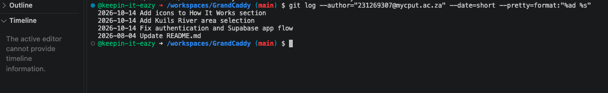

---

## 3. Supabase tables

Screenshots of the three tables I created: structure (column names, types, constraints) and one filled row each (to show the schema is in use, not just designed).

### `users` table

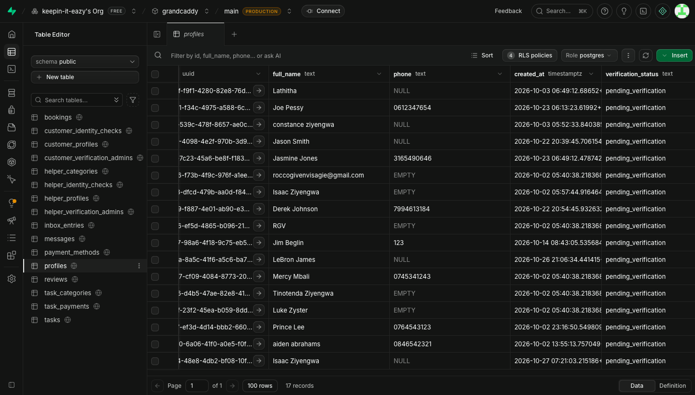

### `tasks` table

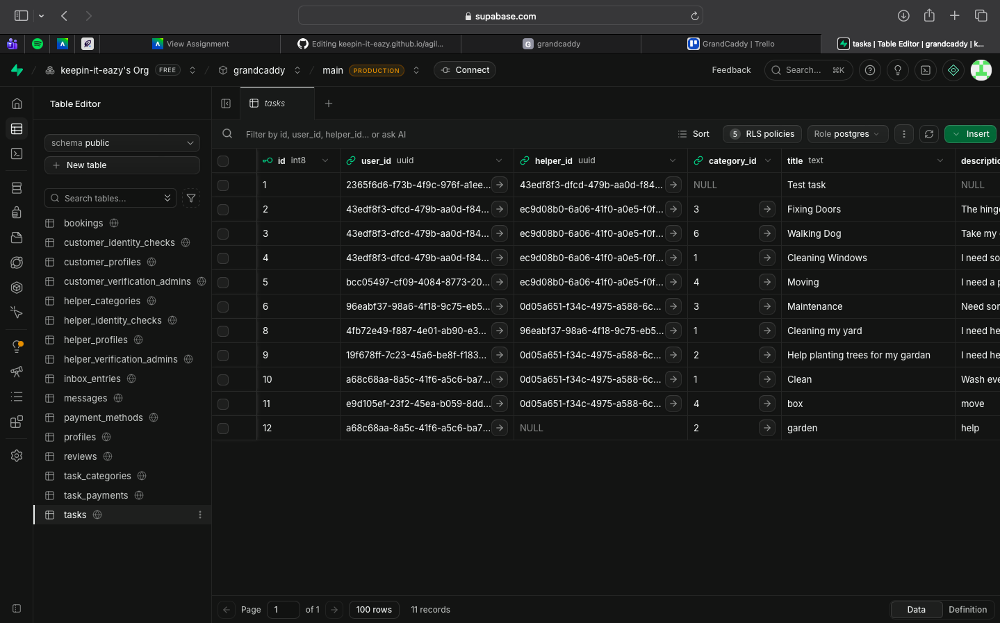

### `task_categories` table

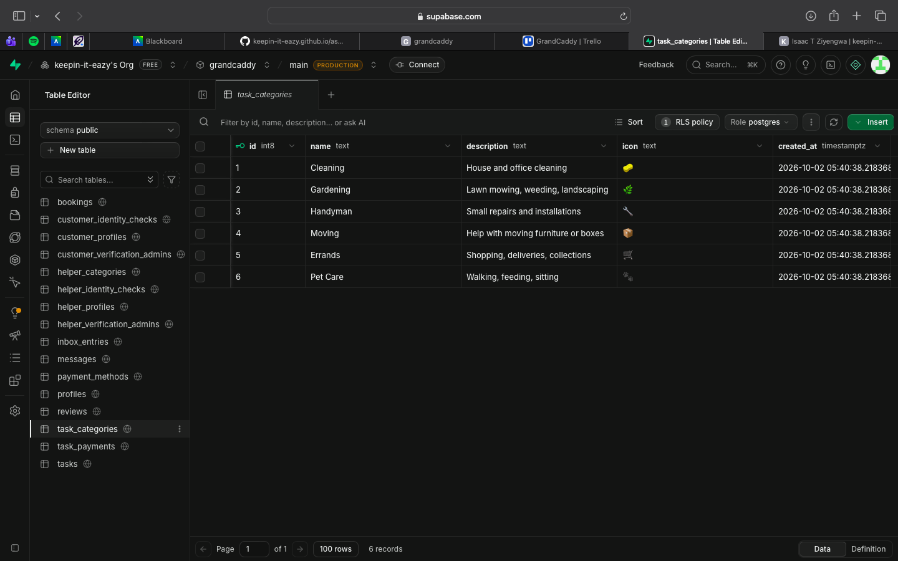

### Row Level Security policies

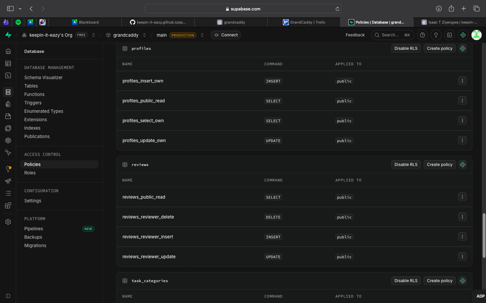

---

## 4. Vercel deployment — live site

The live site is at [grand-caddy.vercel.app](https://grand-caddy.vercel.app). Screenshots below confirm the site renders correctly (not a blank React shell) when opened in a private window while logged out.

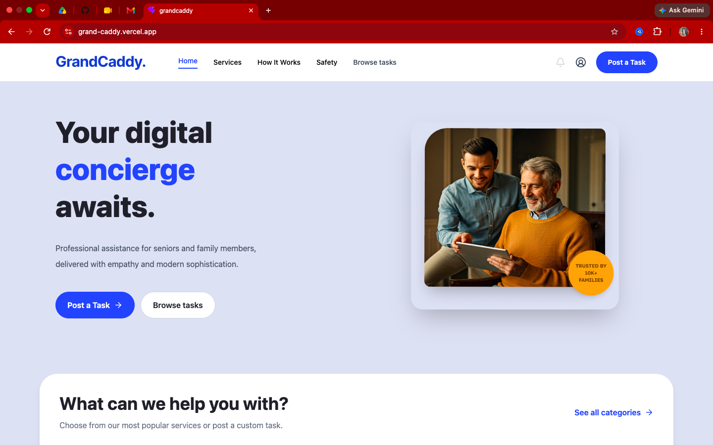
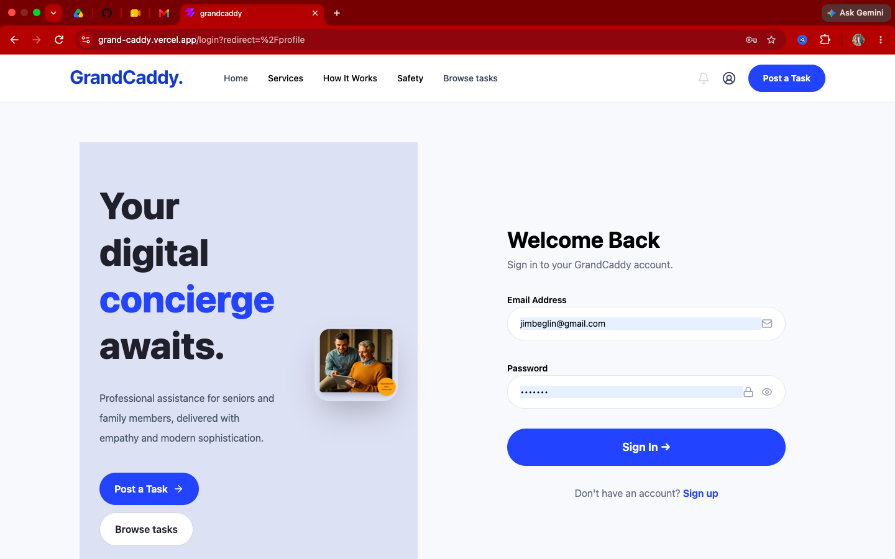
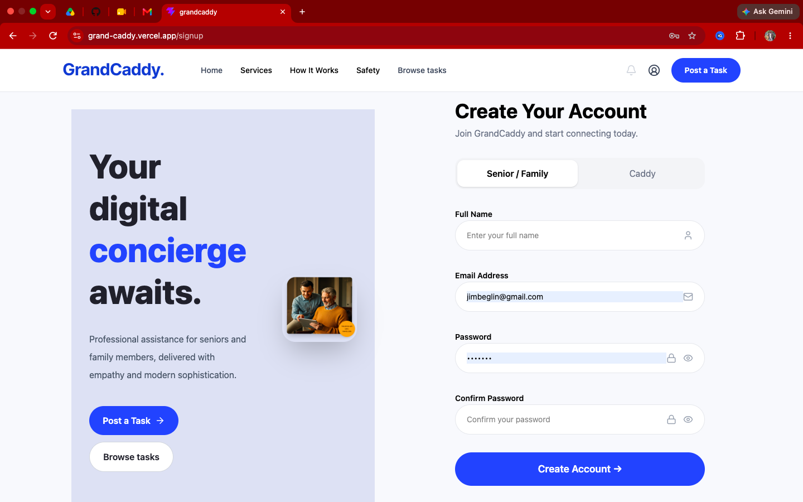

---

## 5. Task briefs — Luke and Rocco

The two briefs I wrote for Luke and Rocco, defining their tasks, file paths, acceptance criteria, and table schemas.

- [Luke's brief](../assets/evidence/brief-luke.txt) — customer experience and auth wiring
- [Rocco's brief](../assets/evidence/brief-rocco.txt) — helper experience

---

## 6. Backlog — Trello board

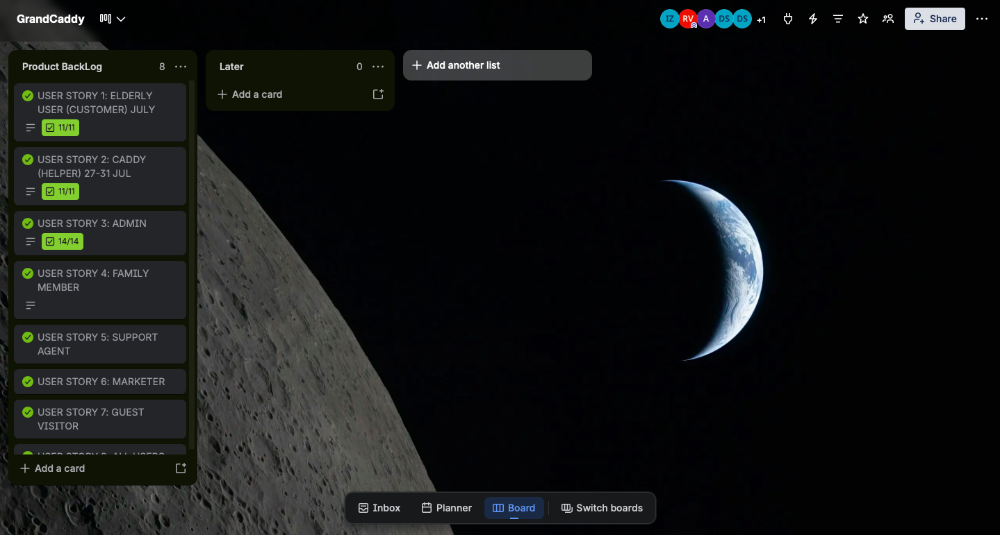

The board is explained in detail on the [Backlog page](backlog.md), including how cards were used during the sprint and the deferred items.

---

## 7. Reflection and logbook

- Full [Reflection](reflection.md) on what I learned and what I'd do differently
- [Sprint Overview](sprint-overview.md) with the full story summary
- [Backlog](backlog.md) with acceptance criteria per story
- Full [Reflection](reflection.md) on what I learned and what I'd do differently
- [Sprint Overview](sprint-overview.md) with the full story summary
- [Backlog](backlog.md) with acceptance criteria per story
